# 🌐 Awesome Edge AI Orchestration & Kubernetes AI ☸️🤖

<p align="center">
  
</p>

<p align="center">
  <a href="https://github.com/ishandutta2007/Awesome-Awesome-Awesome"></a>
  <a href="https://discord.gg/jc4xtF58Ve"></a>
  <a href="https://github.com/ishandutta2007/Awesome-Edge-AI-Orchestration-Kubernetes-AI/stargazers"></a>
  <a href="https://github.com/ishandutta2007/Awesome-Edge-AI-Orchestration-Kubernetes-AI/network/members"></a>
  <a href="https://github.com/ishandutta2007/Awesome-Edge-AI-Orchestration-Kubernetes-AI/issues"></a>
  <a href="https://github.com/ishandutta2007/Awesome-Edge-AI-Orchestration-Kubernetes-AI/blob/main/LICENSE"></a>
  <a href="https://github.com/ishandutta2007"></a>
</p>

---

> **A definitive, curated directory of enterprise SaaS platforms and leading open-source GitHub projects for Edge AI Orchestration, Edge Kubernetes distributions, distributed GPU fleets, and autonomous local edge inference.**

*Last updated: November 2026* ⚡

---

## 📑 Table of Contents
- [📖 Sector Overview & Market Dynamics](#-sector-overview--market-dynamics)
- [☁️ Enterprise SaaS & Hosted Platforms](#️-enterprise-saas--hosted-platforms)
- [🚀 Top Open-Source GitHub Projects](#-top-open-source-github-projects)
- [🛠️ Architectural Blueprints for Edge AI](#️-architectural-blueprints-for-edge-ai)
- [🤝 How to Contribute](#-how-to-contribute)
- [⭐ Star History](#-star-history)
- [⚠️ Disclaimer](#️-disclaimer)

---

## 📖 Sector Overview & Market Dynamics

The global Edge AI market is estimated at **$25B–$30B in 2025–2026** and projected to surge past **$118B–$120B by 2032–2033** at an aggressive **21%–34% CAGR**. Market dynamics reveal a bifurcated landscape: the underlying edge silicon and cloud infrastructure layer is **concentrated** among tech and semiconductor giants (NVIDIA, Google, Microsoft, Amazon), while the software management, edge orchestration, and edge MLOps application layer remains **moderately to highly fragmented** with specialized vendors and open-source stacks competing across retail, robotics, telco 5G, and industrial IoT environments.

---

## ☁️ Enterprise SaaS & Hosted Platforms

The following table compares leading commercial and enterprise SaaS platforms for managing edge Kubernetes, distributed AI inference, and remote device fleets. Sorted by **Company Size / Valuation (Descending)**.

| Platform / Vendor | Company Size / Valuation | Starting Pricing (Specific Tier) | Free Tier / Free Trial Limits | Primary Edge Capabilities |
| :--- | :--- | :--- | :--- | :--- |
| **[NVIDIA Fleet Command](https://www.nvidia.com/en-us/data-center/products/fleet-command/)** | ~$3.5T+ Market Cap | Custom enterprise subscription (~$1,000–$1,200/system/year base tier) | **NVIDIA LaunchPad Free Trial**: Hands-on lab access (typically 14–30 days) with dedicated multi-node GPU edge infrastructure hosted in Equinix data centers | Turnkey hybrid cloud SaaS for zero-touch deployment, GPU driver orchestration, and secure lifecycle management across NVIDIA EGX and Jetson fleets. |
| **[Azure IoT Edge](https://azure.microsoft.com/en-us/products/iot-edge)** | ~$3.1T+ Market Cap | Runtime is free; cloud hub starts at **$25/month** (IoT Hub S1 tier for 400k msgs/day) | **IoT Hub Free Tier (F1)**: **Free forever** for 1 IoT Hub per Azure subscription, up to **8,000 messages/day** across connected edge devices | Containerized edge runtime enabling seamless deployment of Azure Cognitive Services, custom machine learning models, and Azure Functions onto edge gateways. |
| **[AWS IoT Greengrass](https://aws.amazon.com/greengrass/)** | ~$2.2T+ Market Cap | **$0.16 per active device/month** (devices authenticating at least once per month) | **AWS Free Tier**: First **3 active Greengrass Core devices free for 12 months** | Extends AWS cloud capabilities to local edge devices for local AWS Lambda execution, Docker containers, and local SageMaker Neo ML model inference with intermittent connectivity. |
| **[Google Distributed Cloud Edge](https://cloud.google.com/distributed-cloud)** | ~$2.1T+ Market Cap | **$35 per vCPU/month** software subscription (requires 36–60 month contract; min 96 vCPUs/site) | **Custom Enterprise Evaluation**: PoC access via Google Cloud sales team and authorized Systems Integrators | Fully managed edge hardware and software bringing GKE clusters, TPU/GPU acceleration, and Vertex AI edge inference to customer on-premise locations. |
| **[Red Hat OpenShift Edge](https://www.redhat.com/en/technologies/cloud-computing/openshift/edge-computing)** | Subsidiary of IBM (~$200B+ Market Cap) | **$0.04275 per vCPU-hour** ($0.171/hr per 4 vCPUs on AWS ROSA) or $1,000+/node/yr bare-metal subscription | **Red Hat 60-Day Self-Supported Trial**: Full access to OpenShift Container Platform for 60 days on self-hosted infrastructure | Enterprise-grade Kubernetes platform supporting Single Node OpenShift (SNO), remote worker nodes, and air-gapped rollouts with OpenShift AI. |
| **[SUSE Edge](https://www.suse.com/solutions/edge-computing/)** | ~$3B+ Valuation (EQT Private Equity) | **$260 per node/year** (SUSE Linux Enterprise Micro + Rancher Prime edge bundle) | **60-Day Evaluation License**: Free unrestricted evaluation of SUSE Linux Enterprise Micro and Rancher Prime for 60 days | Integrated commercial edge cloud-native stack combining SLE Micro, K3s/RKE2, Rancher Prime, and Edge Image Builder for automated bare-metal edge deployments. |
| **[ZEDEDA](https://zededa.com/)** | ~$400M Valuation ($128M+ funding raised) | **$30,000/year Starter Kit** via AWS Marketplace (covers up to 30 edge nodes; ~$83.33/node/month) | **Guided 30-Day Sandbox Trial**: Cloud orchestration portal access with virtual edge nodes | Cloud-native orchestration SaaS based on LF Edge EVE-OS, delivering zero-trust security, crypto-attestation, and unified container/VM virtualization across edge nodes. |
| **[balenaCloud](https://balena.io/)** | ~$75M Valuation | **$99/month Pilot Plan** (includes 20 devices; additional devices at $3/device/month) | **Starter Free Tier**: **Free forever for your first 10 devices** with full microservice container deployment and community support | Managed container fleet orchestration platform featuring delta OTA updates, remote tunnel access, and automated kernel/OS builds for ARM/x86 AI hardware. |
| **[Spectro Cloud Palette Edge](https://spectrocloud.com/)** | ~$50M+ Raised (Series B) | **$120 per edge node/year** (or compute-based consumption at ~$0.006 per core-hour) | **30-Day Guided Proof-of-Concept**: Free 30-day PoC access with full Palette management console upon demo consultation | Full-stack Kubernetes lifecycle management platform automating bare-metal OS, lightweight K8s (K3s/RKE2), and GPU driver updates across air-gapped edge clusters. |
| **[Avassa](https://avassa.io/)** | ~$25M Valuation (Seed/Series A stage) | Premium plan based on managed hosts (starts from **$15 per active edge host/month** for volume tiers) | **Guided Free Trial Sandbox**: Instant trial environment with Control Tower and 4 pre-configured virtual edge sites | Lightweight edge application orchestration SaaS engineered specifically for distributed retail stores, hospitality, and industrial edge computing. |

---

## 🚀 Top Open-Source GitHub Projects

Curated list of leading open-source projects for edge Kubernetes distributions, GPU scheduling, lightweight runtimes, model serving, and IoT edge networking. **Sorted by GitHub Stars (Descending)**.

| Project | Stars | Focus Category | Description |
| :--- | :--- | :--- | :--- |
| **[Ollama](https://github.com/ollama/ollama)** | [](https://github.com/ollama/ollama/stargazers) | Edge LLM Serving | Lightweight model runner and REST API server frequently containerized on edge K3s nodes for local quantization and low-latency LLM inference. |
| **[vLLM](https://github.com/vllm-project/vllm)** | [](https://github.com/vllm-project/vllm/stargazers) | GPU Inference Engine | High-throughput, memory-efficient LLM inference and serving engine widely deployed inside Kubernetes clusters via PagedAttention and OpenAI-compatible APIs. |
| **[LocalAI](https://github.com/mudler/LocalAI)** | [](https://github.com/mudler/LocalAI/stargazers) | Self-Hosted AI Server | Self-hosted, drop-in OpenAI API replacement running LLMs, multimodal, and audio models locally on consumer GPUs, CPUs, and edge nodes without cloud dependencies. |
| **[Headscale](https://github.com/juanfont/headscale)** | [](https://github.com/juanfont/headscale/stargazers) | Edge Mesh Networking | Open-source, self-hosted implementation of the Tailscale coordination server for secure peer-to-peer WireGuard mesh networks across remote edge nodes. |
| **[Frigate NVR](https://github.com/blakeblackshear/frigate)** | [](https://github.com/blakeblackshear/frigate/stargazers) | Edge Vision Analytics | Complete NVR with real-time AI object detection powered by OpenCV and TensorFlow, using hardware acceleration (Coral TPU, TensorRT) for edge IP cameras. |
| **[Rancher K3s](https://github.com/k3s-io/k3s)** | [](https://github.com/k3s-io/k3s/stargazers) | Edge Kubernetes Distro | Lightweight, CNCF-certified Kubernetes distribution packaged as a single <100MB binary optimized for ARM64, IoT gateways, and resource-constrained edge AI nodes. |
| **[Cilium](https://github.com/cilium/cilium)** | [](https://github.com/cilium/cilium/stargazers) | eBPF Networking & Mesh | eBPF-based high-performance networking, observability, and security mesh connecting distributed and multi-cloud edge Kubernetes clusters. |
| **[EMQX](https://github.com/emqx/emqx)** | [](https://github.com/emqx/emqx/stargazers) | Edge Telemetry Broker | Cloud-native distributed MQTT message broker designed for high-throughput IoT edge-to-cloud telemetry and real-time AI event streaming. |
| **[Talos Linux](https://github.com/siderolabs/talos)** | [](https://github.com/siderolabs/talos/stargazers) | Immutable Edge OS | Modern, immutable, API-driven Linux OS built strictly for Kubernetes, eliminating SSH and package drift across distributed bare-metal and edge GPU fleets. |
| **[Eclipse Mosquitto](https://github.com/eclipse/mosquitto)** | [](https://github.com/eclipse/mosquitto/stargazers) | Lightweight MQTT Broker | Lightweight open-source MQTT message broker ideal for resource-constrained edge gateways and sensor hubs interfacing with edge AI pods. |
| **[Triton Inference Server](https://github.com/triton-inference-server/server)** | [](https://github.com/triton-inference-server/server/stargazers) | Multi-Model Serving | NVIDIA multi-framework inference serving engine optimizing concurrent GPU/CPU model execution across TensorRT, ONNX, PyTorch, and OpenVINO. |
| **[WasmEdge](https://github.com/WasmEdge/WasmEdge)** | [](https://github.com/WasmEdge/WasmEdge/stargazers) | Edge WebAssembly Runtime | CNCF high-performance WebAssembly runtime tailored for edge computing and serverless AI inference with WASI-NN support for PyTorch, TensorFlow, and Llama. |
| **[OpenEBS](https://github.com/openebs/openebs)** | [](https://github.com/openebs/openebs/stargazers) | Edge Persistent Storage | Kubernetes-native Container Attached Storage (CAS) providing persistent block storage for local edge AI databases and inference caches. |
| **[MicroK8s](https://github.com/canonical/microk8s)** | [](https://github.com/canonical/microk8s/stargazers) | Zero-Ops Kubernetes | Canonical zero-ops, single-package CNCF Kubernetes distribution featuring one-command addons for NVIDIA GPU acceleration, Kubeflow, and edge clustering. |
| **[Longhorn](https://github.com/longhorn/longhorn)** | [](https://github.com/longhorn/longhorn/stargazers) | Distributed Edge Storage | Cloud-native distributed block storage system engineered for edge and micro-data center Kubernetes clusters to host AI model weights and state. |
| **[KubeEdge](https://github.com/kubeedge/kubeedge)** | [](https://github.com/kubeedge/kubeedge/stargazers) | Cloud-Edge Orchestration | Graduated CNCF project extending native Kubernetes containerized application orchestration and device management to hosts at the edge with offline autonomy. |
| **[k0s](https://github.com/k0sproject/k0s)** | [](https://github.com/k0sproject/k0s/stargazers) | Frictionless K8s Binary | Zero-friction, lightweight Kubernetes distribution delivered as a single binary with zero external dependencies, perfect for bare-metal edge deployments. |
| **[KServe](https://github.com/kserve/kserve)** | [](https://github.com/kserve/kserve/stargazers) | Serverless AI Inference | Standardized serverless ML inference platform on Kubernetes supporting autoscaling, canary rollouts, and high-performance runtimes like vLLM, Triton, and PyTorch. |
| **[NVIDIA GPU Operator](https://github.com/NVIDIA/gpu-operator)** | [](https://github.com/NVIDIA/gpu-operator/stargazers) | GPU Lifecycle Automation | Open-source Kubernetes operator automating the provisioning of NVIDIA drivers, container toolkits, MIG partitioning, and DCGM monitoring across GPU nodes. |
| **[KubeRay](https://github.com/ray-project/kuberay)** | [](https://github.com/ray-project/kuberay/stargazers) | Distributed Ray on K8s | Open-source Kubernetes operator simplifying deployment and autoscaling of distributed Ray clusters for multi-node AI inference, training, and agent workflows. |
| **[NanoMQ](https://github.com/nanomq/nanomq)** | [](https://github.com/nanomq/nanomq/stargazers) | Embedded Edge Messaging | Ultra-lightweight and blazingly fast MQTT broker designed specifically for resource-constrained edge computing and embedded IoT AI hardware. |
| **[OpenYurt](https://github.com/openyurtio/openyurt)** | [](https://github.com/openyurtio/openyurt/stargazers) | Edge Cluster Extension | CNCF open-source platform transforming standard upstream Kubernetes into an edge-ready cluster with node autonomy, edge-cloud tunneling, and unitized deployment. |
| **[Baetyl](https://github.com/baetyl/baetyl)** | [](https://github.com/baetyl/baetyl/stargazers) | LF Edge Computing Stack | LF Edge open-source cloud-native edge computing framework extending cloud computing, data processing, and AI model inference seamlessly to local edge devices. |
| **[Kairos](https://github.com/kairos-io/kairos)** | [](https://github.com/kairos-io/kairos/stargazers) | Immutable K8s Appliance | Immutable Kubernetes edge OS builder turning standard Linux distributions into cloud-native, tamper-proof edge appliances with secure boot. |
| **[Fleet](https://github.com/rancher/fleet)** | [](https://github.com/rancher/fleet/stargazers) | GitOps Fleet Management | Open-source GitOps container management engine engineered by Rancher to manage up to a million Kubernetes clusters across edge and data center topologies. |
| **[EdgeX Foundry](https://github.com/edgexfoundry/edgex-go)** | [](https://github.com/edgexfoundry/edgex-go/stargazers) | IoT Device Interoperability | LF Edge vendor-neutral open-source microservices framework providing plug-and-play Southbound device connectivity and Northbound data export for edge AI. |
| **[Akri](https://github.com/project-akri/akri)** | [](https://github.com/project-akri/akri/stargazers) | Leaf Device Interface | CNCF Kubernetes resource interface that automatically discovers leaf devices (IP cameras, USB sensors, GPUs) and exposes them as schedulable cluster resources. |
| **[NVKE](https://github.com/dsx-ai-factory/nvke)** | [](https://github.com/dsx-ai-factory/nvke/stargazers) | GPU Orchestration Framework | Open-source Kubernetes-native AI and GPU orchestration framework designed to streamline accelerated AI factory and edge cluster deployments. |
| **[SuperEdge](https://github.com/superedge/superedge)** | [](https://github.com/superedge/superedge/stargazers) | Edge Container Management | Open-source container management system extending native Kubernetes to edge computing with distributed health checks, service groups, and edge-cloud tunnels. |
| **[OpenVINO Model Server](https://github.com/openvinotoolkit/model_server)** | [](https://github.com/openvinotoolkit/model_server/stargazers) | Intel Hardware Serving | Scalable, C++-based open-source microservice optimized for running computer vision and generative AI inference on Intel edge CPUs, iGPUs, and NPUs. |
| **[Savant](https://github.com/insight-platform/Savant)** | [](https://github.com/insight-platform/Savant/stargazers) | DeepStream Video Pipeline | High-performance open-source video analytics framework powered by NVIDIA DeepStream and GStreamer for computer vision on edge AI nodes. |
| **[EVE-OS](https://github.com/lf-edge/eve)** | [](https://github.com/lf-edge/eve/stargazers) | Zero-Trust Virtualization | LF Edge bare-metal edge virtualization engine providing zero-trust security, remote attestation, and container/VM orchestration on distributed edge hardware. |
| **[SpinKube](https://github.com/spinkube/spin-operator)** | [](https://github.com/spinkube/spin-operator/stargazers) | WebAssembly K8s Operator | Open-source Kubernetes operator enabling ultra-fast, low-footprint WebAssembly workloads to run alongside traditional containers on edge clusters. |
| **[Eclipse ioFog](https://github.com/eclipse-iofog/Agent)** | [](https://github.com/eclipse-iofog/Agent/stargazers) | Edge Microservices Network | Open-source edge compute network platform enabling developers to deploy and orchestrate microservices across heterogeneous edge hardware seamlessly. |

---

## 🛠️ Architectural Blueprints for Edge AI

```
                      +---------------------------------------+
                      |       Central Cloud / Control         |
                      |  Rancher Fleet / ArgoCD / KubeRay     |
                      +-------------------+-------------------+
                                          |
                      (mTLS / WireGuard Mesh / Headscale)
                                          |
        +---------------------------------+---------------------------------+
        |                                                                   |
        v                                                                   v
+-------------------------------+                       +-------------------------------+
|     Regional Edge Gateway     |                       |    Far-Edge Micro Cluster     |
| - OS: Talos Linux / Kairos    |                       | - OS: SLE Micro / Alpine      |
| - K8s: K3s / MicroK8s         |                       | - K8s: K3s / k0s              |
| - Ingress: Cilium eBPF Mesh   |                       | - Leaf Resource: Akri         |
| - Storage: Longhorn / OpenEBS |                       | - Telemetry: EMQX / NanoMQ    |
| - AI Serving: vLLM / Triton   |                       | - Inference: Ollama / WasmEdge|
| - Accelerators: GPU Operator  |                       | - Hardware: Jetson / NPU / TPU|
+-------------------------------+                       +-------------------------------+
```

---

## 🤝 How to Contribute

1. 🍴 **Fork the repo**.
2. 🌿 **Create a new branch**: `git checkout -b feature/add-new-tool`.
3. 📝 **Add/edit entries in `README.md`**: Follow existing formatting with valid links, factual data, and proper category classification.
4. 🚀 **Submit a Pull Request** with a descriptive summary of your additions.

⭐ *Don't forget to star the repo if you find it helpful!*

---

## ⭐ Star History

<p align="center">
  <a href="https://star-history.com/#ishandutta2007/Awesome-Edge-AI-Orchestration-Kubernetes-AI&Date">
    
  </a>
</p>

---

## ⚠️ Disclaimer

- 📌 *This repository is a community-curated list and does not constitute an endorsement of any platform or tool.*
- 🔒 *Edge AI deployments operate in physically accessible or intermittent-connectivity environments; always ensure secure boot, disk encryption, mutual TLS (mTLS), and signed container images are strictly enforced.*
- ⚡ *Hardware acceleration (CUDA, ROCm, OpenVINO, Jetson JetPack) requires rigorous kernel and driver compatibility validation prior to rolling out over-the-air (OTA) updates to remote edge fleets.*

---

<p align="center">
  <sub>Crafted with ❤️ for MLOps engineers, edge infrastructure architects, Kubernetes operators, and autonomous AI developers.</sub>
</p>
